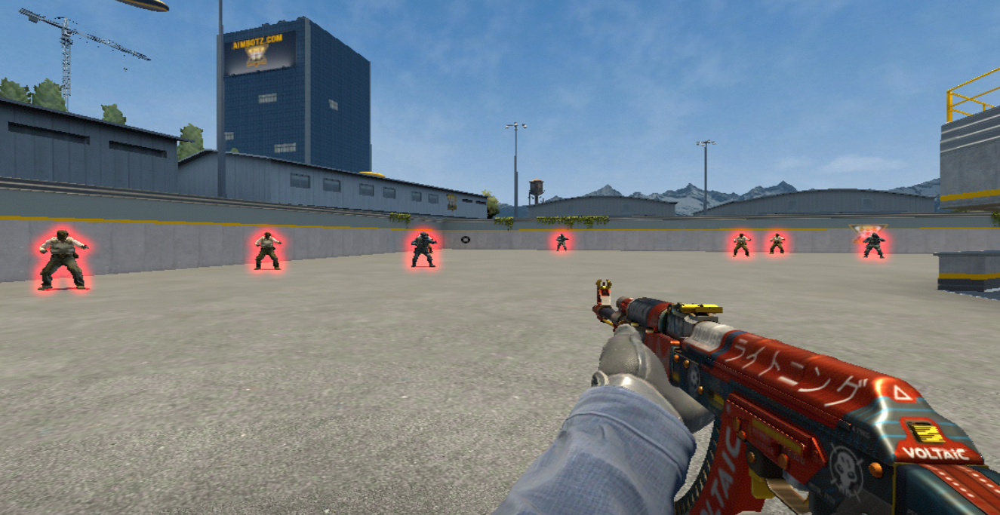

# 🌙 Moonware

<p align="center">
  
</p>

<p align="center">
  <strong>A modern, external Counter-Strike 2 cheat written entirely in Python.</strong>
</p>

---

## 🚀 Install

### Prerequisites
Make sure you have **Python 3.11.4** installed on your system. 

### Installation

1. **Clone the repository:**
   ```bash
   git clone https://github.com
   cd Moonware
   ```

2. **Set up a virtual environment:**
   ```bash
   python -m venv .venv
   source .venv/Scripts/activate  # On Windows/Git Bash
   ```

3. **Install dependencies:**
   ```bash
   pip install -r requirements.txt
   ```

## 🛠️ Usage
1. Launch **Counter-Strike 2**.
2. Run the main script with administrator privileges (required for memory access):
   ```bash
   python main.py
   ```

---
<p align="center">
  <sub>Disclaimer: This project is for educational and research purposes only. Use at your own risk.</sub>
</p>
