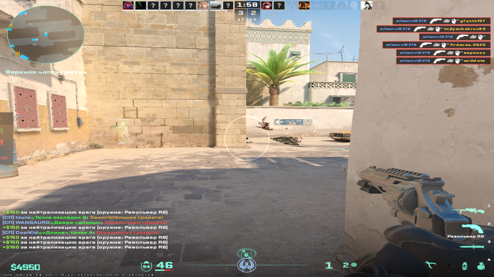
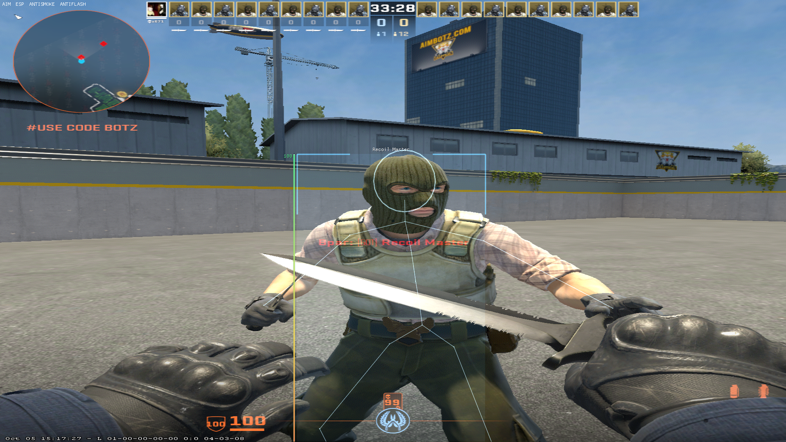
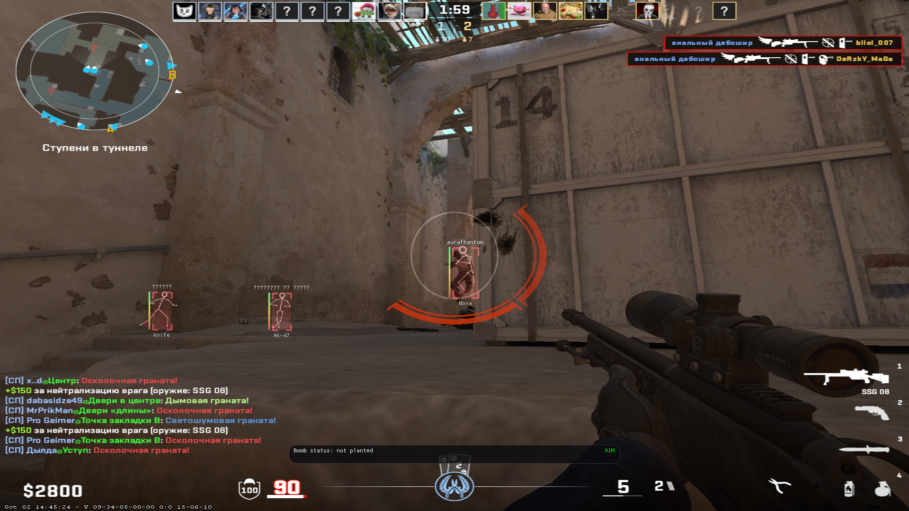

<div align="center">


# Gloom

**Internal Python cheat with a minimal footprint.**

[](https://www.python.org/)
[]()
[]()
[]()
[]()

</div>

---

## Overview

**Gloom** is a cheat written in pure Python and **fully open source**. Every module, every offset, every line of the RPC layer is right here in the tree — nothing is compiled away, nothing is vendored as a black box.

Memory writes are kept narrow and deliberate. Only the visual layer patches the process: **FOV**, **anti-flash**, **anti-smoke** and **glow**. Everything else is driven from the outside.

---

## Features

| Feature | Description |
| :--- | :--- |
| **FOV Changer** | Sets the world FOV and holds it. |
| **Anti-Flash** | Neutralizes the flashbang whiteout in memory. |
| **Anti-Smoke** | Strips smoke density so the cloud becomes see-through. |
| **Glow** | Forces the glow object manager on with a custom color and style. |
| **ESP** | Player boxes, names and health through `entity.py` and `playerState.py`. |
| **Aim** | Target selection and smoothing, no injected mouse hook. |
| **Trigger** | Automatic fire on crosshair overlap. |
| **BHop** | Movement automation. |
| **Crosshair** | Custom crosshair rendering. |
| **RPC Server** | Full local control surface — toggle and tune every feature from any language. |
| **Crash Logging** | Silent crash capture into `crashes/` (see below). |

---

## Why Threading, Not Multiprocessing

Every feature runs in its own `threading.Thread`, and `multiprocessing` is deliberately avoided:

- **Lower memory cost.** A subprocess re-imports the interpreter and the entire dependency tree. Threads share the address space and cost a fraction of that.
- **Faster execution.** No IPC marshalling, no pipe serialization, no pickling. Values written by the RPC layer are visible to the workers instantly.
- **Trivial shared state.** A lock-protected config object is enough. With processes you'd need managers, queues and a synchronization layer for something that fits in a few hundred bytes.

Each worker has its own tick interval, so a slow feature can never stall a fast one.

---

## Detection Surface

- **No injected module** — nothing to find in the game's module list.
- **No hooks, no trampolines** — no patched prologues, no `jmp` detours.
- **Writes are small and rare** — targeted writes instead of wide region dumps.
- **Nothing persistent** — kill the process and the game is back to its original state.

> This is still a cheat. Signature-based anti-cheats and manual review can flag it. Treat "low detection" as *low*, not *zero*.

---

## Screenshots

<div align="center">







</div>

---

## Requirements

- **Windows 10 / 11** (x64)
- **Python 3.14.0** — exactly this version
- The game running in **windowed** or **borderless** mode
- Administrator privileges

---

## Installation

```bash
git clone https://github.com/<your-name>/Gloom.git
cd Gloom
venv.bat
pip install -r requirements.txt
```

With the game already running:

```bash
python main.py
```

`build.sh` produces a standalone build if you'd rather not run it from source.

---

## Crash Logs — read this before reporting a bug

Gloom writes crash and bug reports into the `crashes/` folder. **It never tells you when it happens.** There is no popup, no console line, no tray balloon — if a feature breaks, hangs or takes the process down, the only trace is a new file in `crashes/`.

So when something misbehaves:

1. Open the `crashes/` folder in the repo root.
2. Take the newest file.
3. Attach it to the issue, along with your game build and the feature you were using.

A report without the matching crash file is guesswork. The folder is created on demand, so an empty or missing `crashes/` directory is normal on a clean run.

---

## Configuration

Change settings with config.json.
The menu doesn't work (probably, I don't remember)

---

## Project Structure

```
Gloom/
├── assets/                # font.ttf, csgo_icons.ttf
├── crashes/               # generated at runtime, not tracked
├── images/                # screenshots used in this README
├── internal/
│   ├── crashlog.py        # crash capture into crashes/
│   ├── header.py
│   ├── log.py
│   ├── rpc.py             # JSON-RPC 2.0 over HTTP
│   └── serializer.py
├── src/
│   ├── ui/                # menu.py, panel.py, settings.py, windowctl.py
│   ├── aim.py
│   ├── antiflash.py
│   ├── antismoke.py
│   ├── bhop.py
│   ├── crosshair.py
│   ├── entity.py
│   ├── esp.py
│   ├── fov.py
│   ├── glow.py
│   ├── playerState.py
│   ├── scanner.py
│   └── trigger.py
├── build.sh
├── config.json
├── imgui.ini
├── main.py                # entry point
├── offsets.py
├── requirements.txt
└── venv.bat
```

---

## Updating Offsets

Offsets rot with every game patch. When something stops working after an update, `offsets.py` is the only file you need to touch — `scanner.py` handles base resolution, so in most cases only the signatures have to be refreshed.

---

## Contributing

Pull requests are welcome. Keep the style consistent: one feature per file, one worker thread per feature, no new dependencies unless genuinely unavoidable. Include the crash log if your PR fixes a bug.

---

## Disclaimer

Gloom is an unofficial third-party tool with no affiliation to the game's developers. Use it at your own risk. Offsets, signatures and behavior can break at any time with a game update.

---

<div align="center">

**Written in Python. Stays out of the way.**

</div>
